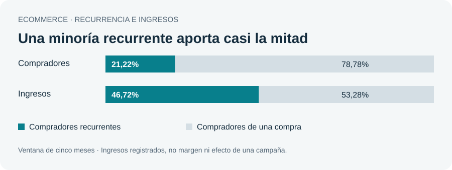

# Ecommerce | Convertir la primera compra en una relación

[← Volver al portfolio](../../README.md) · Business Analytics · Informe de lectura en línea

**Conclusión:** la recurrencia merece atención: el 21,22% de compradores que repite aporta el 46,72% de los ingresos registrados. El siguiente paso propuesto es probar acciones de segunda compra y recuperación, no asumir que una campaña ya generó resultados.

## La pregunta de negocio

¿Qué segmentos conviene priorizar para retención y recuperación, utilizando comportamiento observado en lugar de una campaña indiferenciada?

## Resultados del análisis

| Indicador | Resultado | Lectura de negocio |
| --- | --- | --- |
| Compradores | 11.040 | Base observada del análisis. |
| Compras aproximadas | 15.452 | Sesiones únicas con evento de compra; no pedidos confirmados. |
| Ingresos registrados | 621.549,60 € | No equivalen a beneficio ni margen. |
| Compradores de una sola compra | 78,78% | Segmento relevante para una hipótesis de segunda compra. |
| Clientes de alto gasto y menor recencia | 1.565 | Grupo identificado para evaluar acciones de recuperación. |

## Cómo se abordó

1. Integrar y revisar eventos de cinco meses, de octubre de 2019 a febrero de 2020.
2. Construir una aproximación de compra por sesión y analizar recurrencia y cohortes.
3. Segmentar con RFM: recencia, frecuencia y valor monetario; vincular cada grupo con una acción posible.

## Decisión que informa

- Diferenciar mensajes de segunda compra, fidelización y recuperación según el comportamiento del segmento.
- Diseñar una prueba con grupo de comparación para medir el efecto incremental de una acción.
- Incorporar margen, coste de contacto y devoluciones antes de decidir presupuesto.

## Límites que cambian la interpretación

- La sesión con evento de compra es una aproximación; no sustituye a un identificador de pedido.
- Cinco meses no permiten afirmar retención de largo plazo ni comportamiento anual.
- Los escenarios de segunda compra representan ingresos brutos potenciales, no aumento causal demostrado.
- No se dispone de costes, márgenes ni devoluciones suficientes para demostrar rentabilidad de una campaña.

## Qué demuestra el proyecto

Análisis de clientes, segmentación RFM, cohortes y traducción de hallazgos a hipótesis de negocio comprobables. Esta síntesis no publica registros de clientes ni ofrece resultados de campañas ejecutadas.

**Estado de esta entrega:** conclusiones y visualización agregada disponibles en el navegador, sin instalación ni descarga.
