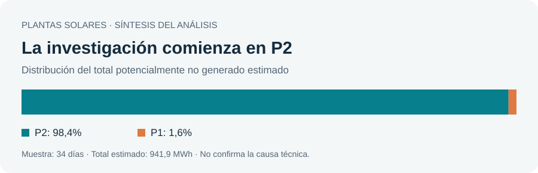

# Plantas solares | Priorizar la investigación operativa

[← Volver al portfolio](../../README.md) · Business Analytics · Informe de lectura en línea

**[Ver todos los materiales completos](https://incut-portfolio-completo.augustopresfraind.chatgpt.site/plantas-solares/)** · [Presentación original: 10 diapositivas](https://incut-portfolio-completo.augustopresfraind.chatgpt.site/plantas-solares/presentacion.html) · [Todos los insights y figuras](https://incut-portfolio-completo.augustopresfraind.chatgpt.site/plantas-solares/analisis-completo.html)

Los enlaces anteriores permiten leer o explorar el material completo en el navegador, sin descargar archivos. Esta ficha es solo una síntesis.

**Conclusión:** concentrar la investigación inicial en P2 y comprobar la calidad de la telemetría antes de atribuir pérdidas a una avería o justificar una intervención.

## La pregunta de negocio

¿Dónde conviene comenzar a investigar para recuperar generación potencial, sin confundir problemas de medición con fallos físicos?

## Resultados del análisis

| Indicador | Resultado | Interpretación |
| --- | --- | --- |
| Ventana observada | 34 días | Muestra corta; no representa por sí sola un año. |
| Energía potencialmente no generada | 941,9 MWh estimados | Estimación analítica, no pérdida causal confirmada. |
| Concentración en P2 | 98,4% | Prioridad de investigación, no diagnóstico de causa. |
| Escenario anual exploratorio | 568.789 €/año | No es ingreso recuperado, ahorro demostrado ni ROI. |

El escenario anual supone que la muestra representa el año, una recuperación del 75% y un precio de 75 €/MWh. Esa extrapolación es orientativa y requiere validación estacional; no incorpora costes de intervención.

## Cómo se abordó

1. Revisar consistencia y calidad de la telemetría de las dos plantas.
2. Analizar desviaciones de generación y estimar la energía potencialmente no generada.
3. Agregar los resultados por planta y traducirlos a una prioridad de investigación y un escenario económico condicionado.

## Decisión que informa

- Comenzar con un piloto acotado en P2, sujeto a validación técnica.
- Contrastar las anomalías con mantenimiento y mediciones independientes antes de asignar causa.
- Evaluar costes, recuperación efectiva y representatividad antes de ampliar el piloto.

## Límites que cambian la interpretación

- La causa técnica de las desviaciones no está confirmada; correlación y anomalía no prueban un fallo.
- Se aplicó una corrección de escala DC de P1 dividiendo por 10, pendiente de verificación técnica.
- Faltan costes y evidencia anual para calcular rentabilidad real de la intervención.
- La estimación y el escenario no constituyen resultados obtenidos en una operación real.

## Qué demuestra el proyecto

Control de calidad de datos, análisis de anomalías, priorización y comunicación de incertidumbre. Esta página sintetiza la documentación del proyecto; no publica trazas ni identificadores operativos y no reproduce los cálculos de forma independiente.

**Estado de esta entrega:** conclusiones disponibles en el navegador; no se ofrece un sistema conectado a plantas reales.

## Lectura y estructura

Esta carpeta contiene la ficha `README.md` con el objetivo, el enfoque, los resultados y sus límites. Los enlaces superiores abren el resumen y los materiales completos en el navegador; no requieren instalación. No se redistribuyen aquí notebooks, datasets ni modelos, por lo que esta ficha no permite reproducir el entrenamiento o los cálculos originales.
